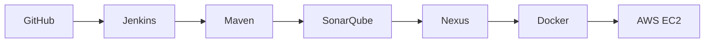

# Somisetty Venkata Surendra Kumar

### Cloud & DevOps Engineer | AWS · CI/CD · Docker · Kubernetes

DevOps Engineer Intern at Q Spiders · B.Tech CSE (2026) · Best Paper Award, ICICC 2026

---

## About

I am a Computer Science graduate and DevOps Engineer Intern at Q Spiders, focused on automating software delivery and running reliable workloads on AWS. My hands-on work covers CI/CD pipelines, containerized deployments, Linux administration, and cloud monitoring and alerting.

I am seeking **Cloud Engineer, DevOps Engineer, and Platform Engineer** roles where I can contribute to automation, reliability, and scalable infrastructure.

---

## Core Skills

| Area | Technologies |
| --- | --- |
| **Cloud (AWS)** | EC2, VPC, S3, EBS, EFS, RDS, IAM, Lambda, ELB/ALB/NLB, Auto Scaling, Route 53, CloudFront, CloudWatch, CloudTrail, SNS, SQS, API Gateway, CloudFormation |
| **CI/CD** | Git, GitHub, GitHub Webhooks, Jenkins, Maven, SonarQube, Nexus |
| **Containers** | Docker, Docker Hub, Kubernetes (Pods, Deployments, Services) |
| **Linux & Scripting** | Permissions, users and groups, processes, filesystems, package management, troubleshooting, Bash |
| **Networking** | TCP/IP, DNS, HTTP/HTTPS, subnetting, CIDR, NAT, load balancing |
| **Monitoring** | Amazon CloudWatch, Amazon SNS, Prometheus, Grafana |
| **Currently learning** | Terraform, Ansible, DevSecOps practices |

---

## Featured Projects

### 1. Automated CI/CD Pipeline for a Java Web Application
**Stack:** Jenkins · Maven · SonarQube · Nexus · Docker · AWS EC2

An end-to-end pipeline that takes a commit through build, test, quality analysis, artifact storage, containerization, and deployment.

- Triggered builds automatically through GitHub webhooks.
- Built, tested, and packaged the application with Maven.
- Enforced code quality gates with SonarQube.
- Stored versioned artifacts in Nexus.
- Containerized the application with Docker and deployed it to AWS EC2.

### 2. AWS Smart Monitoring & Alert Notification System
**Stack:** Amazon S3 · CloudWatch · SNS

A monitoring setup that raises notifications when configured thresholds are crossed.

- Used Amazon S3 as the monitored resource and event source.
- Configured CloudWatch metrics and alarm thresholds.
- Integrated Amazon SNS to deliver alert notifications.

`S3 → CloudWatch → Alarm → SNS → Notification`

### 3. Dockerized Web Application on AWS EC2
**Stack:** Docker · Docker Hub · AWS EC2 · Linux

[View repository](https://github.com/surendra-kumar-07/Docker-web-app)

- Built and tagged Docker images from application source.
- Published images to Docker Hub and pulled them onto an EC2 instance.
- Configured container port mapping and AWS security groups to control inbound traffic.

### 4. Linux Health Check Dashboard
**Stack:** Linux · Bash

[View repository](https://github.com/surendra-kumar-07/linux_health_check_dashboard)

- Shell-based tool that reports system information, disk usage, and memory usage.
- Automates routine health checks to support troubleshooting.

---

## Research & Recognition

**Best Paper Award, ICICC 2026**

*HealthGuard: A Collaborative Machine Learning Approach to Secure Medical Information Across IoT-Driven Healthcare Systems*

- Published by Springer Nature in *Innovative Computing and Communications* (pp. 444–454).
- Research areas: machine learning, IoT security, and healthcare data protection.
- [Read the paper](https://link.springer.com/chapter/10.1007/978-3-032-30008-9_35) · [DOI: 10.1007/978-3-032-30008-9_35](https://doi.org/10.1007/978-3-032-30008-9_35)

---

## Certifications

| Certification | Status |
| --- | --- |
| AWS Certified Cloud Practitioner | In progress |
| SQL (Basic), HackerRank | Completed |
| Operating System Fundamentals, NPTEL | Completed |

---

## Education

**B.Tech, Computer Science and Engineering**, Siddharth Institute of Engineering and Technology
Graduated 2026 · CGPA 8.2 / 10 · Focus areas: Cybersecurity, IoT, Blockchain Technology

---

## Roadmap

- **Kubernetes:** deployments, services, scaling, and application recovery
- **Terraform:** provisioning AWS infrastructure as code
- **Ansible:** server configuration management
- **Prometheus & Grafana:** metrics collection and dashboards
- **DevSecOps:** adding security checks to CI/CD workflows

---

## GitHub Activity

---

## Contact

I am open to Cloud, DevOps, and Platform Engineering opportunities.

**Email:** [surendrasomisetty18@gmail.com](mailto:surendrasomisetty18@gmail.com) · **LinkedIn:** [Somisetty Venkata Surendra Kumar](https://www.linkedin.com/in/somisetty-venkata-surendra-kumar-48b086320/)
