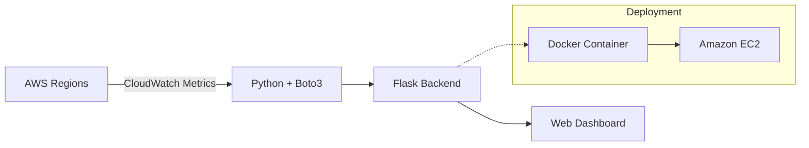
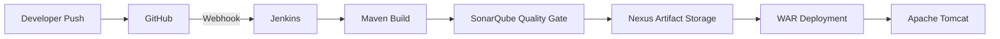
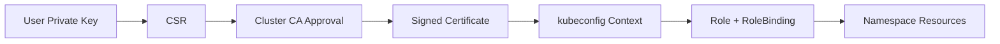
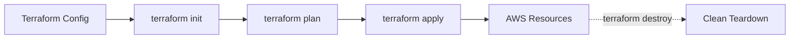
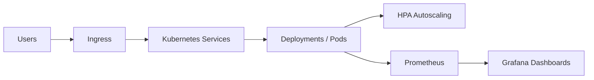
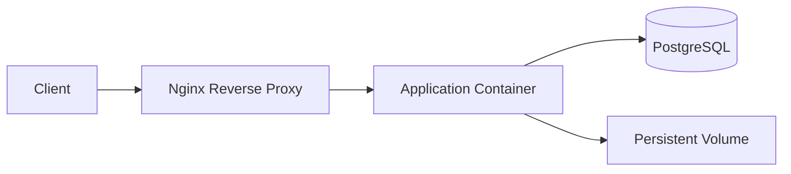

<div align="center">


<br/>

[](https://github.com/surendra-kumar-07)
[](https://www.linkedin.com/in/somisetty-venkata-surendra-kumar-48b086320/)
[](https://github.com/surendra-kumar-07?tab=repositories)


</div>

---

## 👨‍💻 About Me

```yaml
name:        Somisetty Venkata Surendra Kumar
role:        Aspiring AWS Cloud & DevOps Engineer
education:   B.Tech, Computer Science & Engineering
specialization: Cybersecurity, IoT & Blockchain Technology
focus:       Cloud infrastructure, CI/CD, containers, Infrastructure as Code
mindset:     Build. Automate. Deploy.
```

I'm a Computer Science graduate focused on cloud and DevOps engineering. I learn by building: every project here is a hands-on attempt to solve a real infrastructure problem, from automating deployments to securing cluster access and provisioning cloud resources as code.

**What I'm aiming for:** AWS Cloud Engineer · DevOps Engineer

<table>
<tr>
<td width="50%" valign="top">

### 🔭 Currently Working On
- Designing multi-service deployments on AWS
- Extending CI/CD pipelines with containerized stages
- Writing reusable Terraform modules
- Building dashboards with Prometheus & Grafana

</td>
<td width="50%" valign="top">

### 🌱 Currently Learning
- Kubernetes workloads, networking & autoscaling
- AWS architecture best practices (Well-Architected)
- Observability: metrics, logs & alerting
- Ansible configuration management

</td>
</tr>
</table>

---

## 🧰 Tech Stack

<div align="center">


</div>

| Domain | Tools & Services |
|:--|:--|
| ☁️ **Cloud (AWS)** | EC2 · S3 · IAM · VPC · EBS · RDS · Lambda · CloudWatch · Route 53 · CloudFront |
| ⚙️ **CI/CD** | Jenkins · GitHub Actions · Maven · SonarQube · Nexus · GitHub Webhooks |
| 🐳 **Containers & Orchestration** | Docker · Kubernetes (RBAC, CSR, Namespaces) |
| 🏗️ **Infrastructure as Code** | Terraform · Ansible |
| 🐧 **Linux & Scripting** | Linux Administration · Bash · Python (Boto3, Flask) |
| 📊 **Monitoring** | CloudWatch · Prometheus · Grafana |
| 🌐 **Networking** | DNS · HTTP/HTTPS · TCP/IP · Load Balancing |
| 🗄️ **Databases** | MySQL · SQL · Amazon RDS |

---

## 🚀 Featured Projects

### 01 · ☁️ CloudWatchX: AWS Multi-Region Monitoring Dashboard

> A dashboard that collects and visualizes Amazon CloudWatch metrics across multiple AWS regions in one place.



- Pulls CloudWatch metrics from multiple regions using Boto3
- Flask-based dashboard for unified visualization
- Containerized with Docker for portable, repeatable deployments
- Hosted on Amazon EC2


[**→ View Repository**](https://github.com/surendra-kumar-07/CloudWatchX-Multi-Region-AWS-Infrastructure-Monitoring-Dashboard)

---

### 02 · ⚙️ Automated Build-to-Release Solution for a Java Web Application

> An end-to-end Jenkins pipeline that automates source integration, Maven builds, code quality checks, artifact storage, and WAR deployment to Apache Tomcat.



- Automated the release workflow from source code integration through build, quality analysis, artifact storage, and deployment.
- Integrated SonarQube quality gates and Nexus artifact storage to improve code quality and release traceability.
- Automated WAR deployment to Apache Tomcat using Jenkins pipelines for repeatable releases.


[**→ View Repository**](https://github.com/surendra-kumar-07/web-app)

---

### 03 · ☸️ Kubernetes RBAC: Secure Cluster Access Management

> Role-based access control for a Kubernetes cluster, giving users least-privilege access to namespace resources.



- Certificate-based user authentication using the Kubernetes CSR workflow
- Namespace-scoped Roles and RoleBindings
- Fine-grained resource permission management


[**→ View Repository**](https://github.com/surendra-kumar-07)

---

### 04 · 🏗️ AWS Infrastructure Automation with Terraform

> Provisioning and managing AWS infrastructure as code with reusable, parameterized configurations.



- Provider configuration and AWS resource provisioning
- Input variables and outputs for reusable configurations
- Full infrastructure lifecycle management (create, update, destroy)


[**→ View Repository**](https://github.com/surendra-kumar-07)

### 05 · ☸️ Scalable Microservices Platform with Autoscaling and Monitoring

> A Kubernetes-based multi-service platform with traffic routing, autoscaling, rollout controls, and observability.



- Deployed multi-service applications on Kubernetes using Deployments, Services, Ingress, and health probes.
- Configured Horizontal Pod Autoscaling (HPA), rolling updates, and rollback strategies to support application availability.
- Created Prometheus and Grafana dashboards to monitor application performance and resource usage.


[**→ Explore GitHub Repositories**](https://github.com/surendra-kumar-07?tab=repositories)

---

### 06 · 🐳 Containerized Multi-Service Business Application

> A multi-container application setup using Docker Compose, with Nginx as a reverse proxy and PostgreSQL for data storage.



- Containerized an application with Nginx reverse proxy and PostgreSQL using Docker Compose.
- Implemented multi-stage builds, non-root containers, health checks, and persistent volumes.
- Published versioned Docker images to Docker Hub for deployment and rollback.


[**→ Explore GitHub Repositories**](https://github.com/surendra-kumar-07?tab=repositories)

---

## 🏆 Achievements & Experience

| | |
|:--|:--|
| 🥇 **Best Paper Award** | ICICC 2026 |
| 📜 **Certification** | NPTEL: Operating System Fundamentals |
| 📜 **Certification** | HackerRank: SQL (Basic) |
| 💼 **Internship** | Python Django Intern, Assistive Infotech |
| 🎓 **Education** | B.Tech CSE (Cybersecurity, IoT & Blockchain Technology) |

---

## 🗺️ Learning Roadmap


<sub>Dark blue = completed or hands-on · Light blue = in progress · Grey = upcoming</sub>

---

## 📊 GitHub Analytics

<div align="center">


</div>

---

## 🤝 Let's Connect

I'm open to **internships, junior cloud/DevOps roles, and collaboration** on cloud and automation projects.

<div align="center">

[](https://github.com/surendra-kumar-07)
[](https://www.linkedin.com/in/somisetty-venkata-surendra-kumar-48b086320/)

**☁️ Engineer the cloud. Automate the future.**


</div>
