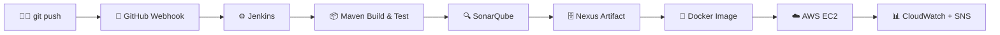

<div align="center">

# `Somisetty Venkata Surendra Kumar`

**Cloud & DevOps engineer in the making — I turn manual deployments into pipelines.**


</div>

---

## 🖥️ `whoami`

```bash
$ whoami
somisetty-venkata-surendra-kumar

$ cat profile.yaml
role:       DevOps Engineer Intern @ Q Spiders
education:  B.Tech CSE (Cybersecurity, IoT & Blockchain) | CGPA 8.2 | 2026
focus:      CI/CD · Containers · AWS · Monitoring
award:      Best Paper, ICICC-2026 (published in Springer)
goal:       Cloud / DevOps / Platform Engineer
status:     building, breaking, fixing, repeating 🔁

$ echo $CURRENT_MISSION
Ship code from `git push` to production — automatically, safely, observably.
```

---

## ⚙️ What I'm Doing Right Now

| | |
|---|---|
| 🔄 **Pipelines** | Building Jenkins CI/CD flows with Maven, SonarQube & Nexus |
| 🐳 **Containers** | Packaging and shipping apps with Docker |
| ☁️ **Cloud** | Working hands-on with AWS infrastructure |
| 📊 **Alerting** | Wiring up CloudWatch + SNS so problems find me first |
| 🎓 **Studying** | AWS Certified Cloud Practitioner *(in progress)* |

---

## 🧬 How My Pipeline Thinks



---

## 🧰 Toolbox

<details open>
<summary><b>☁️ Cloud — AWS</b></summary>
<br>

`EC2` `VPC` `S3` `EBS` `EFS` `RDS` `IAM` `Lambda` `ELB/ALB/NLB` `Auto Scaling` `Route 53` `CloudFront` `CloudWatch` `CloudTrail` `SNS` `SQS` `API Gateway` `CloudFormation` `AWS CLI` `CloudShell`

</details>

<details open>
<summary><b>🔄 CI/CD & Source Control</b></summary>
<br>

`Git` `GitHub` `Jenkins` `Maven` `SonarQube` `Nexus`

</details>

<details>
<summary><b>🐳 Containers & Orchestration</b></summary>
<br>

`Docker` `Docker Hub` `Kubernetes`

</details>

<details>
<summary><b>🏗️ IaC & Automation</b></summary>
<br>

`Terraform` `Ansible` `Bash`

</details>

<details>
<summary><b>🐧 Linux & Networking</b></summary>
<br>

**Linux:** Permissions · Processes · Filesystems · System Administration
**Networking:** TCP/IP · DNS · HTTP/HTTPS · Load Balancing · Subnetting · CIDR · NAT

</details>

<details>
<summary><b>📊 Monitoring</b></summary>
<br>

`CloudWatch` `SNS` `Grafana` `Prometheus`

</details>

---

## 🚀 Featured Projects

### 🔔 S3 Event-Driven Alarm & Notification System
> *"Let the system tell me when something's wrong."*

**Stack:** `S3` `CloudWatch` `SNS`

- Configured CloudWatch alarms driven by S3 activity and error thresholds
- Sent real-time alerts through SNS
- Cut down reliance on manual log checking

### 🔄 CI/CD Automation for a Java Web App
> *"From commit to container, hands-free."*

**Stack:** `Git` `GitHub` `Jenkins` `Maven` `SonarQube` `Nexus` `Docker`

- GitHub webhooks trigger Jenkins builds automatically
- Maven handles build, test and packaging
- SonarQube enforces code quality checks
- Nexus stores build artifacts
- Docker containerizes the app and the deployment is automated

### 🐳 Dockerized Web App on AWS EC2
> *"Build once, run anywhere."*

**Stack:** `Docker` `Docker Hub` `Linux` `EC2`

- Built and versioned custom Docker images
- Published images to Docker Hub and pulled them directly on EC2
- Configured container networking

---

## 🗺️ Roadmap

- [x] Linux
- [x] Git & GitHub
- [x] Maven
- [x] Jenkins
- [x] SonarQube & Nexus
- [x] Docker
- [x] AWS
- [x] CI/CD Automation
- [x] Monitoring & Alerting
- [ ] Kubernetes
- [ ] Terraform & Ansible
- [ ] 🎯 Cloud / DevOps Engineer

---

## 🏆 Recognition & Learning

🏅 **Best Paper Award — ICICC-2026**
*HealthGuard: A Collaborative Machine Learning Approach to Secure Medical Information Across IoT-Driven Healthcare Systems* — published in **Springer**

📜 AWS Certified Cloud Practitioner *(in progress)* · SQL (Basic) — HackerRank · Operating System Fundamentals — NPTEL

---

## 📈 GitHub Activity

<div align="center">

<!-- Replace YOUR_USERNAME with your GitHub username -->


</div>

---

<div align="center">

### 📫 Let's Connect

[](mailto:surendrasomisetty18@gmail.com)

```
Keep Learning • Keep Building • Keep Automating 🚀
```

</div>
