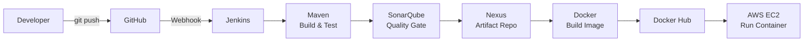
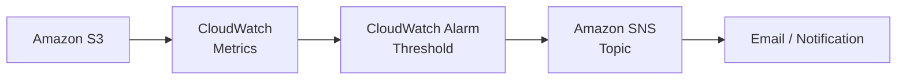
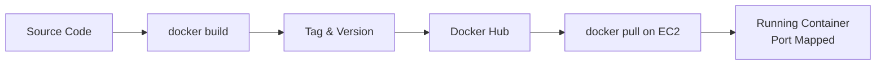

# Somisetty Venkata Surendra Kumar

### Cloud & DevOps Engineer
**AWS · CI/CD · Docker · Kubernetes · Linux · Monitoring**

*I automate software delivery and build observable, reliable cloud systems.*

DevOps Engineer Intern @ Q Spiders &nbsp;|&nbsp; B.Tech CSE '26 &nbsp;|&nbsp; Best Paper Award, ICICC 2026 (Springer)

---

## Profile Summary

Computer Science graduate and DevOps Engineer Intern with hands-on experience designing CI/CD pipelines, containerizing applications, deploying to AWS, and wiring up monitoring and alerting. I care about repeatable releases, early detection of quality issues, and operational visibility. I also have a peer-reviewed publication in machine learning and IoT security.

**Looking for:** Cloud Engineer · DevOps Engineer · Platform Engineer roles.

| Focus | What I do |
| --- | --- |
| **Automate** | Jenkins pipelines, GitHub webhooks, Maven builds, shell scripting |
| **Ship** | Docker images, Docker Hub, EC2 deployments, security groups |
| **Assure** | SonarQube quality gates, Nexus artifact versioning |
| **Observe** | CloudWatch metrics and alarms, SNS notifications, Linux health checks |

---

## Important Projects at a Glance

| # | Project | Domain | Stack | Link |
| --- | --- | --- | --- | --- |
| 1 | Automated CI/CD Pipeline for a Java Web App | CI/CD | Jenkins, Maven, SonarQube, Nexus, Docker, EC2 | [Repositories](https://github.com/surendra-kumar-07?tab=repositories) |
| 2 | AWS Smart Monitoring & Alert System | Cloud Ops | S3, CloudWatch, SNS | [web-app](https://github.com/surendra-kumar-07/web-app) |
| 3 | Dockerized Web App on AWS EC2 | Containers | Docker, Docker Hub, EC2, Linux | [Docker-web-app](https://github.com/surendra-kumar-07/Docker-web-app) |
| 4 | Linux Health Check Dashboard | Linux / Automation | Bash, Linux | [linux_health_check_dashboard](https://github.com/surendra-kumar-07/linux_health_check_dashboard) |
| 5 | HealthGuard (Best Paper, ICICC 2026) | Research / Security | Machine Learning, IoT | [Springer](https://link.springer.com/chapter/10.1007/978-3-032-30008-9_35) |

---

## Project Deep Dives

### 1. Automated CI/CD Pipeline for a Java Web Application

> **Problem:** Manual builds and deployments are slow, inconsistent, and let quality issues slip into releases.
> **Solution:** A fully automated pipeline from commit to running container.

- **Trigger:** GitHub webhooks start builds automatically on every push.
- **Build and test:** Maven compiles, tests, and packages the application.
- **Quality gate:** SonarQube analyzes code before anything is promoted.
- **Artifact management:** Versioned builds are stored in Nexus.
- **Delivery:** The app is containerized with Docker and deployed on AWS EC2.

**Skills demonstrated:** pipeline design, Jenkins automation, quality gates, artifact management, containerized delivery.

---

### 2. AWS Smart Monitoring & Alert Notification System

> **Problem:** Teams find out about cloud issues too late.
> **Solution:** Metric-driven alarms that notify the right people as soon as thresholds are crossed.

- Configured CloudWatch metrics and alarm thresholds for the monitored resource.
- Integrated Amazon SNS to deliver alert notifications to subscribers.
- Improved visibility into the state of cloud resources.

**Skills demonstrated:** CloudWatch, SNS, alarm design, cloud operations.

---

### 3. Dockerized Web Application on AWS EC2

> **Problem:** "Works on my machine" deployments.
> **Solution:** A portable container image, published once and run anywhere.

- Built, tagged, and versioned images, then pushed them to Docker Hub.
- Pulled and ran the container on EC2 with port mapping.
- Controlled inbound traffic using AWS security groups.

**Repository:** [Docker-web-app](https://github.com/surendra-kumar-07/Docker-web-app)

---

### 4. Linux Health Check Dashboard

> **Problem:** Troubleshooting starts with repetitive manual checks.
> **Solution:** A shell-based dashboard that gathers key system health information in one run.

- Reports system information, disk usage, and memory usage.
- Automates routine checks to speed up troubleshooting.

**Repository:** [linux_health_check_dashboard](https://github.com/surendra-kumar-07/linux_health_check_dashboard)

---

### 5. HealthGuard: Secure Medical Information Across IoT Healthcare Systems

> **Best Paper Award, ICICC 2026** · Springer Nature · *Innovative Computing and Communications* (pp. 444–454)

A collaborative machine learning approach to protecting medical data in IoT-driven healthcare environments.

[Read the paper](https://link.springer.com/chapter/10.1007/978-3-032-30008-9_35) · [DOI: 10.1007/978-3-032-30008-9_35](https://doi.org/10.1007/978-3-032-30008-9_35)

---

## Technical Stack

| Area | Technologies |
| --- | --- |
| **AWS compute & networking** | EC2, VPC, ELB/ALB/NLB, Auto Scaling, Route 53, CloudFront |
| **AWS storage & data** | S3, EBS, EFS, RDS |
| **AWS security & governance** | IAM, CloudTrail |
| **AWS serverless & messaging** | Lambda, API Gateway, SNS, SQS |
| **AWS operations & IaC** | CloudWatch, CloudFormation, AWS CLI, CloudShell |
| **CI/CD** | Jenkins, Maven, SonarQube, Nexus, GitHub Webhooks |
| **Containers** | Docker, Docker Hub, Kubernetes (Pods, Deployments, Services) |
| **Linux & networking** | Permissions, processes, filesystems, TCP/IP, DNS, HTTP/HTTPS, CIDR, NAT |
| **Monitoring** | CloudWatch, SNS, Prometheus, Grafana |
| **Learning now** | Terraform, Ansible, DevSecOps |

---

## Engineering Principles

- **Automate the repeatable.** If I do it twice by hand, I script it.
- **Shift quality left.** Catch issues in the pipeline, not in production.
- **Version everything.** Code, artifacts, and container images are all traceable.
- **Make systems observable.** Metrics and alerts come with the deployment, not after it.
- **Least privilege.** Scoped IAM access and tightly configured security groups.

---

## Learning Roadmap

```mermaid
flowchart LR
    A[Linux & Networking] --> B[Git & GitHub] --> C[Maven] --> D[Jenkins CI/CD]
    D --> E[SonarQube & Nexus] --> F[Docker] --> G[AWS]
    G --> H[Monitoring]:::done --> I[Kubernetes]:::next --> J[Terraform & Ansible]:::next --> K[DevSecOps]:::next
    classDef done fill:#2ea44f,color:#fff,stroke:#2ea44f
    classDef next fill:#0969da,color:#fff,stroke:#0969da
```

**Up next:** Kubernetes scaling and recovery, AWS infrastructure with Terraform, configuration management with Ansible, Prometheus and Grafana dashboards, security scanning inside CI/CD.

---

## Certifications & Education

| Credential | Details |
| --- | --- |
| **AWS Certified Cloud Practitioner** | In progress |
| **SQL (Basic)** | HackerRank |
| **Operating System Fundamentals** | NPTEL |
| **B.Tech, Computer Science & Engineering** | Siddharth Institute of Engineering and Technology · 2026 · CGPA 8.2/10 · Cybersecurity, IoT, Blockchain |

---

## GitHub Activity

 

---

## Contact

Open to Cloud, DevOps, and Platform Engineering opportunities.

**Email:** [surendrasomisetty18@gmail.com](mailto:surendrasomisetty18@gmail.com) &nbsp;·&nbsp; **LinkedIn:** [Somisetty Venkata Surendra Kumar](https://www.linkedin.com/in/somisetty-venkata-surendra-kumar-48b086320/)
