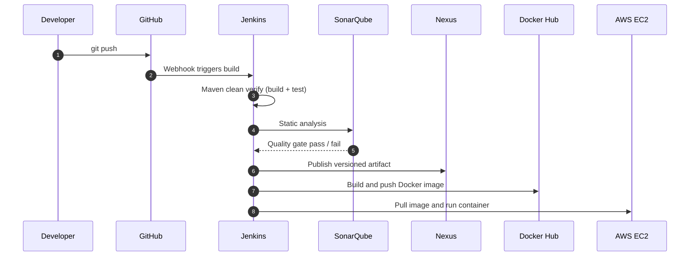
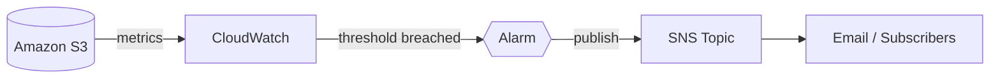
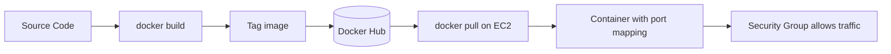

<div align="center">


<br/>

[](https://www.linkedin.com/in/somisetty-venkata-surendra-kumar-48b086320/)
[](mailto:surendrasomisetty18@gmail.com)
[](https://link.springer.com/chapter/10.1007/978-3-032-30008-9_35)

</div>

---

## At a Glance

<div align="center">

| 🏆 **Best Paper Award** | 📄 **Springer Publication** | ⚙️ **10-Stage CI/CD Pipeline** | ☁️ **18+ AWS Services** | 🎓 **CGPA 8.2 / 10** |
| :---: | :---: | :---: | :---: | :---: |
| ICICC 2026 | Pages 444–454 | Commit → Production | Compute · Storage · Ops | B.Tech CSE, 2026 |

</div>

**Somisetty Venkata Surendra Kumar** is a DevOps Engineer Intern at **Q Spiders** who builds the automation that gets code from a commit to a monitored production workload. I work across Jenkins, Docker, AWS and Linux, and I have published peer-reviewed research in IoT security.

> 🎯 **Open to:** Cloud Engineer · DevOps Engineer · Platform Engineer roles

---

## What I Deliver

| | Capability | Evidence |
| :---: | --- | --- |
| ⚙️ | **Replace manual releases with pipelines** | Jenkins pipeline triggered by GitHub webhooks, from build to EC2 deployment |
| 🔍 | **Block poor code before it ships** | SonarQube quality gates inside the pipeline |
| 📦 | **Make releases traceable and repeatable** | Nexus artifacts and tagged Docker Hub images |
| 🐳 | **Remove environment drift** | Containerized apps run identically on any host |
| 📊 | **Detect problems early** | CloudWatch alarms routed to SNS notifications |
| 🐧 | **Speed up troubleshooting** | Bash health checks for CPU, disk and memory |

---

## Featured Projects

### 🚀 1. Automated CI/CD Pipeline for a Java Web Application


**Challenge:** Manual builds and deployments were slow, inconsistent and let quality problems reach release.
**Solution:** A pipeline that takes every push through build, test, analysis, storage, packaging and deployment with no manual steps.



**Outcomes**
- ✅ Builds start automatically on every push through a GitHub webhook.
- ✅ Releases only move forward when the SonarQube quality gate passes.
- ✅ Every build produces a versioned artifact and a tagged image, so any release can be traced and redeployed.
- ✅ Deployment to EC2 runs from the pipeline, not from a person's terminal.

<details>
<summary><b>🔧 Technical detail: pipeline design (representative Jenkinsfile outline)</b></summary>

```groovy
pipeline {
  agent any
  tools { maven 'Maven3' }
  stages {
    stage('Checkout')      { steps { git branch: 'main', url: '<repo-url>' } }
    stage('Build & Test')  { steps { sh 'mvn clean verify' } }
    stage('Code Analysis') { steps { withSonarQubeEnv('sonarqube') { sh 'mvn sonar:sonar' } } }
    stage('Quality Gate')  { steps { timeout(time: 5, unit: 'MINUTES') { waitForQualityGate abortPipeline: true } } }
    stage('Publish')       { steps { sh 'mvn deploy -DskipTests' } }       // to Nexus
    stage('Docker')        { steps { sh 'docker build -t <user>/<app>:${BUILD_NUMBER} . && docker push <user>/<app>:${BUILD_NUMBER}' } }
    stage('Deploy')        { steps { sh 'ssh <ec2-host> "docker pull <user>/<app>:${BUILD_NUMBER} && docker run -d -p 80:8080 <user>/<app>:${BUILD_NUMBER}"' } }
  }
}
```

**Design decisions**
- `abortPipeline: true` makes the quality gate a hard stop, not a warning.
- Images are tagged with the Jenkins build number so every deployment maps to one build.
- Credentials for Nexus, Docker Hub and SSH belong in the Jenkins credential store, never in the repository.

</details>

---

### ☁️ 2. AWS Smart Monitoring & Alert Notification System


**Challenge:** Cloud issues are often discovered by users before the team.
**Solution:** Metric-based alarms that push notifications to subscribers the moment a threshold is crossed.



**Outcomes**
- ✅ Alarm thresholds defined on S3 metrics, with state changes evaluated automatically.
- ✅ SNS topic delivers alerts to every subscriber without polling dashboards.
- ✅ Gives the team visibility into the monitored resource before users notice a problem.

<details>
<summary><b>🔧 Technical detail: alarm and notification wiring (illustrative AWS CLI)</b></summary>

```bash
# 1. Notification channel
aws sns create-topic --name s3-alerts
aws sns subscribe --topic-arn <topic-arn> --protocol email --notification-endpoint <email>

# 2. Alarm that publishes to the topic
aws cloudwatch put-metric-alarm \
  --alarm-name s3-bucket-size-high \
  --namespace AWS/S3 --metric-name BucketSizeBytes \
  --dimensions Name=BucketName,Value=<bucket> Name=StorageType,Value=StandardStorage \
  --statistic Average --period 86400 --evaluation-periods 1 \
  --threshold <bytes> --comparison-operator GreaterThanThreshold \
  --alarm-actions <topic-arn>
```

**Design decisions**
- Separating the SNS topic from the alarm lets several alarms share one notification channel.
- Thresholds are chosen per metric, because S3 storage metrics report daily while request metrics are near real time.

</details>

---

### 🐳 3. Dockerized Web Application on AWS EC2

[](https://github.com/surendra-kumar-07/Docker-web-app)


**Challenge:** Deployments that work on one machine and fail on another.
**Solution:** A portable image built once, published to a registry and run identically on EC2.



**Outcomes**
- ✅ One tagged image reproduces the same runtime on any host.
- ✅ Application reachable through mapped ports, with inbound traffic restricted by security groups.
- ✅ Image versioning enables quick rollback to a previous tag.

<details>
<summary><b>🔧 Technical detail: build, publish and run (illustrative commands)</b></summary>

```bash
docker build -t <user>/webapp:1.0 .
docker push  <user>/webapp:1.0

# On the EC2 instance
docker pull <user>/webapp:1.0
docker run -d --name webapp -p 80:<container-port> <user>/webapp:1.0
docker ps && docker logs webapp
```

**Design decisions**
- Explicit version tags instead of `latest`, so deployments are reproducible.
- Security group opens only the ports the application needs.

</details>

---

### 🖥️ 4. Linux Health Check Dashboard

[](https://github.com/surendra-kumar-07/linux_health_check_dashboard)


**Challenge:** Troubleshooting begins with the same repetitive manual checks every time.
**Solution:** A shell script that collects the key health indicators in a single run.

**Outcomes**
- ✅ One command replaces several manual checks of system info, disk and memory.
- ✅ Consistent output that is easy to compare across servers.
- ✅ Reusable base for scheduled checks with cron.

<details>
<summary><b>🔧 Technical detail: checks performed (representative)</b></summary>

```bash
uptime            # load average and uptime
df -h             # disk usage per filesystem
free -h           # memory and swap
ps aux --sort=-%mem | head -5   # top memory consumers
```

</details>

---

### 🔬 5. HealthGuard: Secure Medical Data Across IoT Healthcare Systems

<div align="center">


</div>

A collaborative machine learning approach to protecting patient information in IoT-driven healthcare environments, published by **Springer Nature** in *Innovative Computing and Communications* (pp. 444–454).

[](https://link.springer.com/chapter/10.1007/978-3-032-30008-9_35)
[](https://doi.org/10.1007/978-3-032-30008-9_35)

---

## Tech Stack

<div align="center">


</div>

| Layer | Technologies |
| --- | --- |
| ☁️ **AWS** | EC2 · VPC · S3 · EBS · EFS · RDS · IAM · Lambda · ELB/ALB/NLB · Auto Scaling · Route 53 · CloudFront · CloudWatch · CloudTrail · SNS · SQS · API Gateway · CloudFormation |
| ⚙️ **CI/CD** | Git · GitHub · Webhooks · Jenkins · Maven · SonarQube · Nexus |
| 🐳 **Containers** | Docker · Docker Hub · Kubernetes (Pods, Deployments, Services) |
| 🐧 **Linux & Networking** | Permissions · processes · filesystems · Bash · TCP/IP · DNS · HTTP/S · CIDR · NAT |
| 📊 **Observability** | CloudWatch · SNS · Prometheus · Grafana |
| 🌱 **Learning now** | Terraform · Ansible · DevSecOps |

---

## Roadmap


🟢 Completed &nbsp; 🔵 In progress / next

---

## Certifications & Education

| Credential | Status |
| --- | --- |
| ☁️ AWS Certified Cloud Practitioner | In progress |
| 💻 SQL (Basic), HackerRank | Completed |
| 🖥️ Operating System Fundamentals, NPTEL | Completed |
| 🎓 B.Tech CSE, Siddharth Institute of Engineering and Technology | 2026 · CGPA 8.2/10 · Cybersecurity, IoT, Blockchain |

---

## GitHub Activity

<div align="center">


</div>

---

<div align="center">

## Let's Build Something Reliable

Open to **Cloud, DevOps and Platform Engineering** roles.

[](https://www.linkedin.com/in/somisetty-venkata-surendra-kumar-48b086320/)
[](mailto:surendrasomisetty18@gmail.com)


</div>
